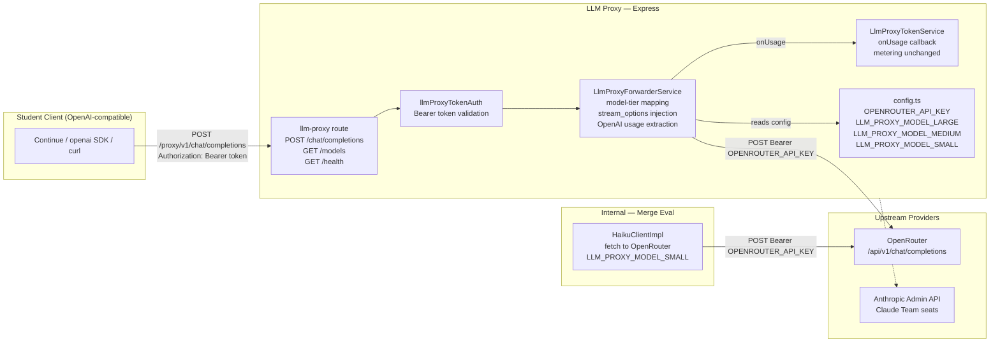
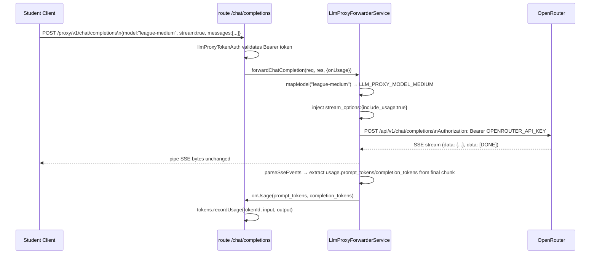

<!-- CLASI: Before changing code or making plans, review the SE process in CLAUDE.md -->

# Architecture Update — Sprint 001: Re-point LLM Proxy at OpenRouter

## What Changed

### Protocol Switch: Anthropic Messages API → OpenRouter OpenAI Chat Completions

The LLM proxy forwarder changes from targeting Anthropic's proprietary Messages
API (`POST https://api.anthropic.com/v1/messages`, `x-api-key` / `anthropic-version`
headers, Anthropic-specific SSE event shapes) to targeting OpenRouter's OpenAI-compatible
Chat Completions endpoint (`POST https://openrouter.ai/api/v1/chat/completions`,
`Authorization: Bearer` header, OpenAI SSE shape).

No translation layer is introduced. The proxy is a clean passthrough: students send
OpenAI-format bodies; the proxy forwards them as-is (after model-tier substitution)
to OpenRouter; OpenRouter returns OpenAI-format responses. The proxy pipes bytes
back to the client.

### New Abstraction: League Model Tiers

Three operator-controlled model tiers replace the previous hardcoded Claude model
slugs. The mapping is:

| Tier | Env var | Default slug |
|------|---------|--------------|
| LARGE | `LLM_PROXY_MODEL_LARGE` | `deepseek/deepseek-v4-pro` |
| MEDIUM | `LLM_PROXY_MODEL_MEDIUM` | `deepseek/deepseek-v4-flash` |
| SMALL | `LLM_PROXY_MODEL_SMALL` | `deepseek/deepseek-v3.2` |

Client-provided model strings are matched by pattern:

- `league-large` / `large` / `opus` → LARGE
- `league-medium` / `medium` / `sonnet` → MEDIUM
- `league-small` / `small` / `haiku` → SMALL
- Unknown or absent → MEDIUM (cost-control default)

The operator can change which slugs back each tier via env vars without a code
deployment.

### Route Rename

`POST /proxy/v1/messages` is replaced by `POST /proxy/v1/chat/completions`.
An optional `GET /proxy/v1/models` endpoint is added listing the three tiers.
The `/health` endpoint is unchanged. CORS allow-headers drop `anthropic-version`,
`anthropic-beta`, and `x-api-key`; only `Content-Type` and `Authorization` are
needed for the OpenAI protocol.

### Config Keys Added

Five new keys are registered in `config.ts` CONFIG_KEYS:

| Key | Secret | requiresRestart | Notes |
|-----|--------|-----------------|-------|
| `OPENROUTER_API_KEY` | yes | false | Bearer key for OpenRouter |
| `LLM_PROXY_BASE_URL` | no | false | Override upstream URL |
| `LLM_PROXY_MODEL_LARGE` | no | false | Default: `deepseek/deepseek-v4-pro` |
| `LLM_PROXY_MODEL_MEDIUM` | no | false | Default: `deepseek/deepseek-v4-flash` |
| `LLM_PROXY_MODEL_SMALL` | no | false | Default: `deepseek/deepseek-v3.2` |

`ANTHROPIC_API_KEY` is relabelled in CONFIG_KEYS to "Claude Admin API Key" to
make clear it serves only `anthropic-admin.client.ts`, not the proxy.

### Merge Eval Client

`haiku.client.ts` switches from the `@anthropic-ai/sdk` package (which requires
`ANTHROPIC_API_KEY`) to a `fetch`-based call to OpenRouter, using `OPENROUTER_API_KEY`
and `LLM_PROXY_MODEL_SMALL`. The `HaikuClient` interface and error types
(`HaikuApiError`, `HaikuParseError`) are preserved so callers require no changes.

---

## Why

1. **Client compatibility**: The League is moving from Claude Code (Anthropic-only) to
   OpenAI-compatible clients (Continue, standard openai SDKs). The proxy must speak
   the same protocol as the clients — no translation layer, no divergence. (SUC-001,
   SUC-003)
2. **Provider flexibility**: Hardcoded Claude slugs tied the League to Anthropic pricing
   and model lifecycle. Config-driven tiers allow the operator to switch models or
   providers without a code change. (SUC-002, SUC-004)
3. **Dependency reduction**: `haiku.client.ts` importing `@anthropic-ai/sdk` creates a
   dependency on `ANTHROPIC_API_KEY` for an internal use that is unrelated to Claude
   Team seat provisioning. Switching it to fetch/OpenRouter consolidates LLM calls
   under a single key and provider. (SUC-005)

---

## Impact on Existing Components

### Components That Change

| Component | Change |
|-----------|--------|
| `server/src/services/llm-proxy-forwarder.service.ts` | Full rewrite — new URL, headers, key resolution, model mapping, stream_options injection, OpenAI usage field extraction |
| `server/src/services/config.ts` | Add 5 keys; relabel ANTHROPIC_API_KEY label |
| `server/src/routes/llm-proxy.ts` | Rename /messages → /chat/completions; add GET /models; update CORS; update /health response body |
| `server/src/app.ts` | Update GET /proxy self-doc JSON (advertise chat/completions, not messages) |
| `client/src/components/LlmProxyUsage.tsx` | Replace Claude Code / Anthropic curl snippets with OpenAI-compatible setup |
| `client/src/pages/LlmProxy.tsx` | Copy sweep: remove Anthropic/Claude Code references |
| `client/src/pages/account/AccountLlmProxyCard.tsx` | Copy sweep: remove Anthropic/Claude Code references |
| `server/src/services/merge/haiku.client.ts` | Replace Anthropic SDK with fetch to OpenRouter |
| `config/dev/secrets.env.example` | Add OPENROUTER_API_KEY; clarify ANTHROPIC_API_KEY comment |
| `config/prod/secrets.env.example` | Same as dev |
| `config/dev/public.env` | Add LLM_PROXY_BASE_URL and model tier vars as commented defaults |
| `config/prod/public.env` | Same as dev |
| `tests/server/services/llm-proxy-forwarder.service.test.ts` | Full rewrite for OpenAI path |

### Components Unchanged

| Component | Reason |
|-----------|--------|
| `server/src/middleware/llmProxyTokenAuth.ts` | Already validates `Authorization: Bearer`; no change |
| `server/src/services/llm-proxy-token.service.ts` | `onUsage(inputTokens, outputTokens)` callback contract is unchanged; metering is unaffected |
| `server/src/services/anthropic/anthropic-admin.client.ts` | Anthropic Admin API for Claude Team seat management; no OpenRouter equivalent; untouched |
| All other routes and services | Unaffected by this sprint |

---

## Component / Module Diagram

---

## Data Flow — Streaming Path

---

## Design Rationale

### Decision: No Translation Layer

**Context**: The old proxy forwarded to Anthropic. A translation layer could serve
both old (Anthropic) and new (OpenAI) clients simultaneously.

**Alternatives considered**:
- Dual-protocol: proxy accepts both `/messages` and `/chat/completions`. Rejected:
  maintains dead code; the League has no need to support Claude Code after the switch.
- Translation layer (convert OpenAI → Anthropic → OpenAI): rejected — adds complexity,
  latency, and a new failure mode. Not needed since OpenRouter speaks OpenAI natively.

**Why this choice**: A clean cut is simpler. Students reconfigure once. OpenRouter
accepts OpenAI bodies directly. The proxy shrinks (loses Anthropic-specific header
and SSE parsing logic).

**Consequences**: Students using Claude Code will break after the switch. This is
intentional; the League is migrating to OpenAI-compatible tools.

---

### Decision: Config-Driven Model Tiers

**Context**: The previous proxy hardcoded `claude-sonnet-4-6` and
`claude-haiku-4-5-20251001`. Any model change required a code deployment.

**Alternatives considered**:
- Pass model string through unchanged: rejected — removes cost-control gate;
  students could specify expensive models.
- Hardcode DeepSeek slugs: rejected — same lifecycle churn in different clothing.

**Why this choice**: `LLM_PROXY_MODEL_*` env vars give the operator a configuration
surface to change models without a deployment. Tier-name aliases (`league-large` etc.)
give students stable names that survive backend model changes.

**Consequences**: Operator sets three model env vars at deploy time (sensible defaults
provided in templates). Students learn three tier names instead of specific model slugs.

---

### Decision: Reuse `parseSseEvents` Unchanged

**Context**: The SSE byte-parsing helper splits on blank lines and extracts `data:`
lines. Both Anthropic and OpenAI SSE use this envelope format identically.

**Alternatives considered**:
- Separate helpers per protocol: unnecessary — the envelope is identical.

**Why this choice**: The helper is correct. Only the per-event field extraction
changes (`usage.prompt_tokens` / `usage.completion_tokens` in the final OpenAI chunk
vs. `message_start` / `message_delta` in Anthropic).

**Consequences**: None. The change is localised to the `onSseEvent` callback.

---

### Decision: Inject `stream_options: { include_usage: true }`

**Context**: OpenAI streaming responses omit usage by default. The proxy needs
token counts for per-student quota metering.

**Alternatives considered**:
- Require students to send `stream_options` themselves: rejected — leaks an internal
  metering requirement to students.
- Skip metering for streaming calls: rejected — creates uncontrolled quota drift.

**Why this choice**: The proxy silently injects the field on all streaming requests.
Students get correct metering without any configuration burden.

**Consequences**: Every streaming request carries an extra field (minimal overhead).

---

## Open Questions

None. All design decisions are resolved. Implementation may proceed.

---

## Migration Concerns

1. **Student reconfiguration**: Students using Claude Code must switch to an
   OpenAI-compatible client and update `OPENAI_BASE_URL` / `OPENAI_API_KEY`. Existing
   bearer tokens are unchanged. The student setup page will show updated instructions
   after ticket 004.
2. **API key**: `OPENROUTER_API_KEY` must be set before deploying. `ANTHROPIC_API_KEY`
   remains in use for `anthropic-admin.client.ts` (Claude Team seat provisioning) and
   is not removed.
3. **Hard cutover**: The old `/proxy/v1/messages` route is removed. There is no
   rollback path that preserves both endpoints simultaneously. Deploy only when
   students are ready to reconfigure.
4. **haiku.client.ts dependency**: `@anthropic-ai/sdk` is no longer imported in
   `haiku.client.ts`. If it is used nowhere else in the server package, it can be
   removed from `package.json` in a follow-up.
