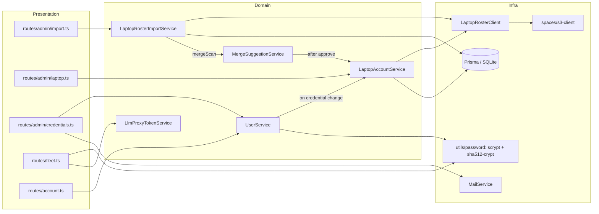

<!-- CLASI: Before changing code or making plans, review the SE process in CLAUDE.md -->

# Sprint 002: Laptop accounts live in student-accounts

## Goals

Make student-accounts the one place a League student has an account, and
make that account work on the League laptops. Bring the existing laptop
roster in with a one-time import (group "Botball 26"), push credentials
back out to the roster from here, give instructors the controls they have
been missing (set username, set password, email credentials), let the
laptops fetch the student's LLM proxy token at login, and make account
merging safe for the duplicates the import will surface.

## Problem

The laptops (repo `ubuntu-install`) grew their own account system: a roster
in the Spaces bucket `jtl-student-unix-accounts` (`students/<id>/config.json`
with a SHA-512 crypt password hash), created on the laptop itself. This
app knows nothing about it, so a student can have two unconnected
accounts, an instructor cannot set a student's username or password here,
and laptop students have no way to get the LLM proxy token everyone else
gets. Merging two accounts today silently drops proxy tokens, group
memberships and credentials.

## Solution

1. **Crypt hashes.** Teach `utils/password.ts` to verify and produce SHA-512
   crypt (`$6$`) hashes next to scrypt; keep a per-user `laptop_password_hash`
   so the roster can be rewritten any time.
2. **Spaces roster client.** Extract the S3 client from the backup service;
   add a small roster client (list, read, write).
3. **One-time import.** Admin action (and script) that creates a user with
   username + `$6$` hash per roster entry, in group "Botball 26", with a
   `username` Login row, and runs the merge scan.
4. **Write-back.** `LaptopAccountService.reconcile(user)` writes the roster
   entry for every active student with a username and password, locks it
   (`!`) otherwise; called from every credential/flag/status change; a
   dirty flag plus an hourly job retries failures and backs "Push all".
   Laptop-compatible username rules.
5. **Admin credentials.** Set username, set or generate a password, email
   credentials to an address of the admin's choosing.
6. **Laptop login cards.** Account page and admin detail panel show the
   laptop login state.
7. **Fleet endpoint.** `POST /api/fleet/llm-token` {username, password} →
   the student's `llmp_` token and usage; auto-grant for laptop students.
8. **Merge.** `approve()` moves everything; rule-based suggestions for
   imported usernames; admin manual merge; richer queue view.
9. **Deployment docs.** Fix the drift found in the 2026-10-17 review and
   write the deploy runbook the stakeholder will run.

## Success Criteria

- Running the import against a fake roster of N entries creates N users
  (minus matches) in "Botball 26"; a second run changes nothing.
- An imported student signs in here with their laptop password; after
  that, a password change here produces a roster entry the laptops accept
  (`$6$` hash verifies against the new password; `created` preserved).
- An admin can set a student's username and password and email them to
  any address; the audit log records it without the password.
- `POST /api/fleet/llm-token` with valid credentials returns a working
  proxy token (second call returns the same one); wrong password → 401;
  six failures → 429.
- Approving a merge keeps the survivor's laptop login working and keeps
  the proxy token and group memberships.
- `npm run test:server` and `npm run test:client` pass; `tsc --noEmit`
  clean for server and client; no new lint errors beyond the 12 already
  on master.

## Scope

### In Scope

The six linked issues: `import-laptop-roster-into-botball-26-group.md`,
`laptop-account-management-in-student-accounts.md`,
`admin-set-username-password-and-email-credentials.md`,
`fleet-llm-token-endpoint-for-laptop-login.md`,
`merge-handles-laptop-accounts-and-moves-everything.md`,
`deploy-current-master-and-fix-deployment-docs.md` (docs and runbook only).

### Out of Scope

- Renaming a username that already has a roster entry (needs a bucket
  move; follow-up issue). Students see the username locked once pushed.
- Deploying to production (the stakeholder runs the runbook).
- Dollar budgets, the Anthropic endpoint, LLM pages: sprint 003.
- Changes to the laptops themselves (`ubuntu-install`,
  `docs/issue-laptop-accounts-move-to-student-accounts.md` there).
- Moving production from SQLite to Postgres.

## Test Strategy

Vitest on the real SQLite test database (`tests/server/setup.ts`), supertest
for routes, fakes injected through constructors as the codebase already
does (`tests/server/helpers/`): a `FakeLaptopRosterClient` (in-memory map
of id → entry, records writes), the existing fake Haiku client for merge
scans, a fake mail transport. Crypt hashes in tests come from the new
`makeCryptHash` and are cross-checked once against a fixture produced by
`openssl passwd -6`. Client components get vitest + testing-library tests
in `tests/client/` following `AdminUsersPanel.test.tsx`. Every ticket runs
the full server suite before marking done; the last ticket runs both
suites plus `tsc --noEmit` for server and client.

## Architecture

### Architecture Overview

New module `server/src/services/laptop/` owns everything about the roster:

- **LaptopRosterClient** (infrastructure): `listIds()`, `read(id)`,
  `write(id, entry)`. Knows the bucket layout and nothing about users.
- **LaptopRosterImportService** (domain): one-time import; depends on the
  roster client, Prisma, `GroupService`, audit, `mergeScan`.
- **LaptopAccountService** (domain): decides whether a user should have a
  roster entry and what it contains; `reconcile(userId)`, `pushAll()`.
  Called by `UserService` (credentials), admin routes (flags, deactivate),
  `MergeSuggestionService` (after approve) and the hourly job.
- **utils/password** gains `isCryptHash`, `verifyCryptHash`,
  `makeCryptHash`, `generatePassword`; `verifyPassword` dispatches on the
  hash format. One implementation of SHA-512 crypt, used by both import
  and write-back.
- **Fleet route**: thin; credential check through `verifyPassword`, token
  through a new `LlmProxyTokenService.ensureActive`.

Data model changes (Prisma): `User.laptop_password_hash String?`,
`User.allows_laptop_account Boolean @default(true)`,
`User.laptop_roster_dirty Boolean @default(false)`,
`CreatedVia.laptop_import`. No new tables.

### Design Rationale

- **Not a provider.** Decision 2026-10-17: a laptop login is just the
  username and password a user already has here. So there is no
  `Login.provider = 'laptop'`, no recurring sync, and imported users get
  the same `username` Login row that passphrase signup creates.
  Alternative (a `laptop` provider with periodic sync) was rejected as a
  second identity system.
- **Store the crypt hash, not just scrypt.** The roster must be
  rewritable without the plaintext (push-all, merges, repairs), and
  computing crypt requires the plaintext, so it is computed at set time
  and kept in `laptop_password_hash`. Alternative (laptops verifying
  scrypt) would mean changing every laptop's PAM path; rejected.
- **Lock, never delete.** `students/<id>/` also holds the student's synced
  work. Deactivation writes `password_hash: "!"`, which the laptops
  already reject.
- **Synthesised email `<id>@laptop.invalid`.** `primary_email` is required
  and unique; `.invalid` cannot be delivered to by construction, so a
  mistaken send is impossible. Alternative (making `primary_email`
  nullable) touches sign-in matching everywhere; rejected for this sprint.
- **Write-back failures do not fail user actions.** Spaces being down must
  not block a password change; a dirty flag and an hourly retry job
  reconcile. This mirrors the fire-and-forget usage accounting already in
  the proxy.
- **Fleet endpoint returns the proxy token, not a session.** The laptop is
  a machine client; a cookie session would be wrong. Same token the
  student sees on their Account page, so there is one credential.

### Migration Concerns

- Prisma migration adds three nullable/defaulted columns and one enum
  value; safe on SQLite with existing rows.
- The import is a one-time admin action; it is idempotent, so running it
  twice is harmless.
- Until the laptops stop creating accounts (`ubuntu-install` change), both
  sides may write the roster; the importer can be re-run to pick up
  stragglers (matched-by-username entries are left alone).
- `verifyPassword` accepting `$6$` hashes in `password_hash` is a
  behaviour change only for imported rows; scrypt rows are unaffected.
- Deployment itself is out of scope; the runbook ticket documents it.

## Use Cases

### SUC-001: Import the laptop roster
Parent: UC (admin provisioning)

- **Actor**: Administrator
- **Preconditions**: Spaces credentials for the roster bucket configured;
  group name chosen (default "Botball 26").
- **Main Flow**:
  1. Admin clicks "Import laptop roster…", confirms the group name.
  2. The app lists `students/*/config.json`, creates a user per entry not
     already present (username, display name, `$6$` hash, synthesised
     email, `username` Login, group membership), skips reserved ids,
     and runs the merge scan for each new user.
  3. Admin sees the report (created / matched / skipped / errors).
- **Postconditions**: Every roster student exists here once and is in the
  group; duplicates appear in the merge queue.
- **Acceptance Criteria**:
  - [ ] Second run reports all entries as matched.
  - [ ] Imported user can sign in here with their laptop password.

### SUC-002: Student's credentials reach the laptops
Parent: UC (account self-service)

- **Actor**: Student (or admin acting on a student)
- **Preconditions**: User is an active student with `allows_laptop_account`.
- **Main Flow**:
  1. User sets or changes username/password here.
  2. The app stores scrypt + crypt hashes and writes
     `students/<username>/config.json`.
  3. Student chooses "Other..." on a laptop and logs in.
- **Postconditions**: Roster entry verifies against the password; prior
  `created`/`created_host` preserved.
- **Acceptance Criteria**:
  - [ ] Deactivated / opted-out user's entry is locked (`!`).
  - [ ] Write failure sets `laptop_roster_dirty`; the job clears it.

### SUC-003: Admin sets username and password and emails them
Parent: UC (admin account management)

- **Actor**: Administrator
- **Main Flow**:
  1. On the user detail panel, admin sets a username (validated), sets or
     generates a password, and sends "Your League account" to an address
     they type (prefilled from the user's email).
- **Postconditions**: Student can sign in; audit shows events without the
  password; roster updated.
- **Acceptance Criteria**:
  - [ ] `.invalid` recipient refused.
  - [ ] Generated password shown once.

### SUC-004: Laptop fetches the student's LLM token at login
Parent: UC (LLM proxy)

- **Actor**: Laptop (`league-helper login`) on behalf of the student
- **Main Flow**:
  1. POST `/api/fleet/llm-token` with username and password.
  2. App verifies (scrypt or crypt), ensures an active token exists
     (auto-grant for laptop students), returns token + usage + base URL.
- **Acceptance Criteria**:
  - [ ] Same token on repeat calls; rotate returns a new one.
  - [ ] 401 on bad credentials, 403 when not allowed, 429 after 5 failures.

### SUC-005: Admin merges an imported account into an existing one
Parent: UC (duplicate resolution)

- **Actor**: Administrator
- **Main Flow**:
  1. Merge queue shows a rule-based suggestion (same username / local part
     / display name) or admin starts a manual merge.
  2. Admin approves with a survivor.
  3. Logins, external accounts, groups, proxy token, username + hashes
     and flags move; roster re-pointed.
- **Acceptance Criteria**:
  - [ ] Survivor keeps a working laptop login and proxy token.

### SUC-006: Student sees their laptop login state
Parent: UC (account self-service)

- **Actor**: Student
- **Main Flow**: Account page shows a "Laptop login" card: ready / locked /
  set a password / username invalid, with instructions.
- **Acceptance Criteria**:
  - [ ] Card states match server state.

### SUC-007: Admin sees and repairs laptop login state
Parent: UC (admin account management)

- **Actor**: Administrator
- **Main Flow**: Detail panel card shows flag, dirty state, "Push now";
  "Push all" on the admin laptop page.
- **Acceptance Criteria**:
  - [ ] Push all rewrites every eligible entry and reports counts.

### SUC-008: Deploy runbook and corrected docs
Parent: UC (operations)

- **Actor**: Administrator
- **Main Flow**: Follows `docs/deploy.md` to deploy master; docs agree on
  domain and database.
- **Acceptance Criteria**:
  - [ ] Stack header, templates, README and schema comments corrected.

## GitHub Issues

None.

## Definition of Ready

- [x] Sprint planning document is complete (sprint.md, including its
      Architecture and Use Cases sections)
- [x] Architecture review passed
- [x] Stakeholder has approved the sprint plan (stakeholder asked for the
      sprint to run unattended on 2026-10-17: "I'm going to let you just do
      that stuff and crank it out")

## Tickets

| # | Title | Depends On |
|---|-------|------------|
| 001 | Password utils: SHA-512 crypt verify/make, laptop_password_hash, laptop_import, .invalid mail guard | |
| 002 | Spaces client extraction and LaptopRosterClient | |
| 003 | One-time laptop roster import (service, admin endpoint, script) | 001, 002 |
| 004 | Laptop account write-back: LaptopAccountService, hooks, username rules, push job | 001, 002 |
| 005 | Admin credentials: set username/password, generate, email | 004 |
| 006 | Laptop login cards on Account page and admin detail panel | 004 |
| 007 | Fleet LLM token endpoint with auto-grant | 001 |
| 008 | Merge completeness, rule-based suggestions, manual merge, queue view | 003, 004 |
| 009 | Deployment docs drift and deploy runbook | |

Tickets execute serially in the order listed.

## Test baseline on master (2026-10-18, before this sprint)

`npm run test:server`: 1799 passed, 39 failed, in these files only (pre-existing;
two of them flaky on "Unable to start a transaction in the given time"):

- `tests/server/auth-flows.integration.test.ts` (1)
- `tests/server/schema-t005.test.ts` (3)
- `tests/server/services/claude-provisioning.service.test.ts` (14, flaky)
- `tests/server/services/workspace-provisioning.service.test.ts` (20, flaky)
- `tests/server/services/auth/google-admin-directory.client.test.ts` (1, path-dependent)

`npm run test:client`: 367 passed, 0 failed. `tsc --noEmit`: clean for server
and client. `npm run lint` (server): 12 errors, 2 warnings, pre-existing.

Rule for this sprint: every other test file stays green, these five may stay
red, nothing new goes red, no new lint errors.
