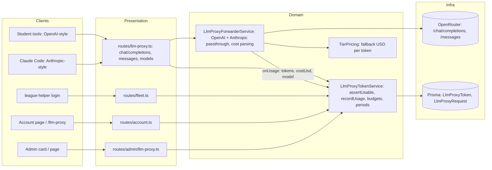

<!-- CLASI: Before changing code or making plans, review the SE process in CLAUDE.md -->

# Sprint 003: LLM proxy: dollar budgets, Claude Code, and visibility

## Goals

Turn the LLM proxy's quota into a real monthly dollar budget ($5 default,
settable per student), let Claude Code work through the proxy via an
Anthropic-compatible endpoint, and give both students and instructors a
clear view: a tight card plus a full page of setup examples for every tool
on the student side, and a card plus full page with the key, spend and an
editable limit on the admin side.

## Problem

The proxy meters a lifetime token count that is not money, never resets,
and needs an admin re-grant when exhausted (`LlmProxyToken.token_limit`).
It speaks only the OpenAI protocol since sprint 001, so Claude Code cannot
use it. The student card carries stale snippets and no full setup page; the
admin card shows a token count and grant/revoke, with no key, no dollars,
no limit control (stakeholder, 2026-10-17).

## Solution

1. **Dollars.** Ask OpenRouter for cost on every request
   (`usage: {include: true}`), record `cost_usd` per request in a new
   `LlmProxyRequest` log, keep `spent_usd` per token with a monthly period
   that resets lazily at the first request of a new UTC month, enforce
   `spent_usd >= budget_usd` before forwarding, fall back to a per-tier
   price table when OpenRouter reports no cost. Default budget from config
   (`LLM_PROXY_DEFAULT_BUDGET_USD = 5`); admin PATCH to change it.
2. **Claude Code.** `POST /proxy/v1/messages` passes Anthropic-format
   requests through to OpenRouter's Anthropic-compatible endpoint with the
   same tier mapping (extended to `claude-*` names) and usage parsing from
   `message_start` / `message_delta`, behind `LLM_PROXY_ANTHROPIC_ENABLED`.
3. **Student UX.** A shared `LlmProxySetupExamples` component (Claude Code,
   curl, Continue, OpenCode, Hermes, Python, generic env); the Account card
   shrinks to figures + key + one button; `/llm-proxy` becomes the full
   page.
4. **Admin UX.** `UserLlmProxyCard`: dollar meter, editable limit, masked
   key with reveal/copy, OpenRouter activity link, "Open LLM page";
   `/admin/users/:id/llm-proxy` renders the same examples with the
   student's token and a recent-requests table.
5. **Docs.** Runbook and README updated for the new keys and migration.

## Success Criteria

- A token with `budget_usd = 0.01` is refused with 429 "monthly budget"
  after a request or two; `LlmProxyRequest` rows carry non-zero
  `cost_usd`; forcing `period_start` into last month makes the next
  request reset `spent_usd` and succeed.
- `claude -p "say hi"` with `ANTHROPIC_BASE_URL=<proxy>` and
  `ANTHROPIC_AUTH_TOKEN=llmp_…` gets a reply (manual, post-deploy); the
  unit tests cover streaming and non-streaming usage parsing and tier
  mapping for `claude-*` names.
- Student card has no code blocks; `/llm-proxy` shows seven examples each
  containing the real token and endpoint; Claude tab hidden when the flag
  is off.
- Admin card shows `$x of $y`, saves a new limit (audited), reveals/copies
  the key; the admin page renders the examples for that student.
- Suites and type-checks as in sprint 002 (baseline failures only; no new
  lint errors).

## Scope

### In Scope

The four linked issues: `llm-proxy-dollar-budgets-with-monthly-reset.md`,
`anthropic-compatible-proxy-endpoint-for-claude-code.md`,
`student-llm-proxy-page-with-setup-examples.md`,
`admin-llm-usage-visibility-and-dollar-limits.md`.

### Out of Scope

- Per-student OpenRouter keys (rejected; see the budgets issue).
- Account-wide monthly cap (`LLM_PROXY_MONTHLY_CAP_USD`): optional in the
  issue, deferred.
- Deploying to production; the stakeholder runs `docs/deploy.md`.
- Laptop-side changes (`ubuntu-install`).

## Test Strategy

As sprint 002: vitest on the SQLite test DB, supertest routes, injected
fakes. The forwarder tests use fixture bodies for OpenAI and Anthropic
shapes (streaming SSE and non-streaming) against a fake `fetch`. Budget
logic is tested at the token-service level with controlled clocks
(inject `now()`). Client tests cover the shared examples component (each
template contains token + endpoint), the two cards and the two pages.
Full server suite before each ticket is marked done; the last ticket runs
both suites plus both `tsc --noEmit`.

## Architecture

### Architecture Overview

- **LlmProxyTokenService** owns budgets: `assertUsable` (expiry, revoked,
  lazy monthly reset, `spent_usd >= budget_usd` or legacy token check when
  `budget_usd` is null), `recordUsage({inputTokens, outputTokens, costUsd,
  modelRequested, modelSent, protocol})` writing the request row and the
  running totals, `setBudget`.
- **LlmProxyForwarderService** gains a second passthrough (Anthropic) that
  shares fetch/stream/abort plumbing; both report usage through one
  `onUsage(usage: UsageReport)` shape. Cost comes from OpenRouter's
  `usage.cost` when present, else `TierPricing`.
- **Client**: one `LlmProxySetupExamples` component and `llm-examples/*`
  template functions, rendered by the student page and the admin page.

Data model: `LlmProxyToken` + `budget_usd Decimal?`, `spent_usd Decimal
@default(0)`, `spent_usd_total Decimal @default(0)`, `period_start
DateTime?`; new `LlmProxyRequest {id, token_id, user_id, ts, protocol,
model_requested, model_sent, input_tokens, output_tokens, cost_usd,
status}`. (SQLite stores Decimal as text through Prisma; use `Float` if the
adapter complains, documented in the ticket.)

### Design Rationale

- **Lazy monthly reset at request time**, not a cron: the check runs on
  every authenticated request anyway, needs no scheduler, and matches
  OpenRouter's midnight-UTC semantics. Alternative (nightly job) adds a
  moving part and a window where the old period is still enforced.
- **Cost from OpenRouter, fallback to a price table**: accounting must
  never silently record zero; the table is config so an unpriced model
  can be fixed without a deploy.
- **Passthrough, not translation, for Anthropic**: OpenRouter already
  speaks the Anthropic protocol; translating in the proxy would duplicate
  that and drift. Sprint 001 made the same call for OpenAI.
- **Keep `token_limit` working while `budget_usd` is null** so existing
  tokens behave until backfilled; the admin PATCH and new grants set a
  budget.
- **One examples component** so student and admin never show different
  instructions.

### Migration Concerns

- One Prisma migration (four nullable/defaulted columns, one table); safe
  on SQLite. Existing tokens get `budget_usd = NULL` and keep the token
  quota; a backfill admin action "Set default budget on all tokens" sets
  $5 where null (part of ticket 001).
- `LLM_PROXY_ANTHROPIC_ENABLED` default flips to `true`; `docs/deploy.md`
  says how to turn it off if OpenRouter's endpoint misbehaves.
- The fleet endpoint from sprint 002 already emits `anthropic_base_url`
  when the flag is on; no laptop change needed.
- Request log retention: prune rows older than 90 days in the existing
  daily backup job (ticket 001).

## Use Cases

### SUC-001: Budget enforcement in dollars
- **Actor**: Student's tool, via the proxy
- **Main Flow**: request → token valid → period reset if a new month →
  `spent_usd < budget_usd` → forward → cost recorded; else 429 with
  "monthly budget" message.
- **Acceptance Criteria**:
  - [ ] Over-budget → 429; new month → reset; legacy null budget → token check.

### SUC-002: Claude Code through the proxy
- **Actor**: Student using Claude Code
- **Main Flow**: `ANTHROPIC_BASE_URL=<proxy>`, `ANTHROPIC_AUTH_TOKEN=llmp_…`
  → `POST /proxy/v1/messages` → tier-mapped → OpenRouter Anthropic endpoint
  → usage recorded.
- **Acceptance Criteria**:
  - [ ] Streaming and non-streaming usage parsed; `x-api-key` and Bearer accepted; 404 when disabled.

### SUC-003: Student sets up any tool
- **Actor**: Student
- **Main Flow**: Account card → "Set up and details" → `/llm-proxy` → copy
  the example for their tool.
- **Acceptance Criteria**:
  - [ ] Seven examples with real token/endpoint; Claude hidden when disabled.

### SUC-004: Admin sees key and spend, sets limit
- **Actor**: Administrator
- **Main Flow**: user detail → LLM card: `$x of $y`, reveal/copy key, edit
  limit → saved and audited.
- **Acceptance Criteria**:
  - [ ] Limit change reflected on the student's page.

### SUC-005: Admin walks a student through setup
- **Actor**: Administrator
- **Main Flow**: "Open LLM page" → `/admin/users/:id/llm-proxy` → examples
  with that student's token; recent requests table.
- **Acceptance Criteria**:
  - [ ] Page renders the shared component with the student's token.

### SUC-006: Laptop and account payloads carry dollars
- **Actor**: Laptop / student
- **Main Flow**: `POST /api/fleet/llm-token` and `GET /api/account/llm-proxy`
  return `budgetUsd`, `spentUsd`, `periodResetsAt`.
- **Acceptance Criteria**:
  - [ ] Fields present and consistent with the admin view.

## GitHub Issues

None.

## Definition of Ready

- [x] Sprint planning document is complete
- [x] Architecture review passed
- [x] Stakeholder has approved the sprint plan (same unattended-run
      instruction as sprint 002, 2026-10-17)

## Tickets

| # | Title | Depends On |
|---|-------|------------|
| 001 | Budget data model and token service: dollars, monthly period, request log, admin budget PATCH | |
| 002 | Forwarder cost accounting: usage.include, cost parsing, fallback pricing, new onUsage shape | 001 |
| 003 | Anthropic-compatible /proxy/v1/messages passthrough for Claude Code | 002 |
| 004 | Student: shared setup-examples component, tightened card, full /llm-proxy page | 001, 003 |
| 005 | Admin: LLM card with dollars, limit, key; admin LLM page with examples and recent requests | 004 |
| 006 | Docs: deploy runbook and README for the new keys, migration, Anthropic flag | 005 |

Tickets execute serially in the order listed.

## Test baseline

Inherited from sprint 002 (see that sprint's "Test baseline" section): five
server test files fail on master before this sprint (39 tests, two files
flaky on transaction timeouts), plus rare single-test 404/ECONNRESET flakes
under full-suite load. Client suite green, `tsc` clean, server lint 12
pre-existing errors.
